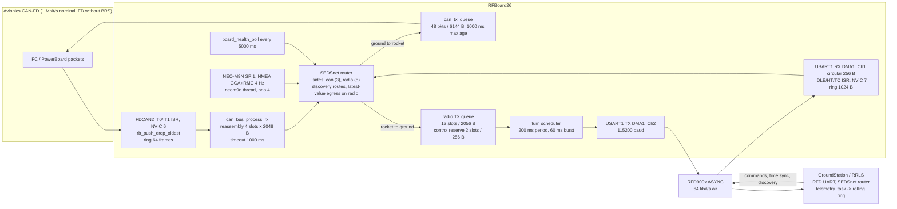
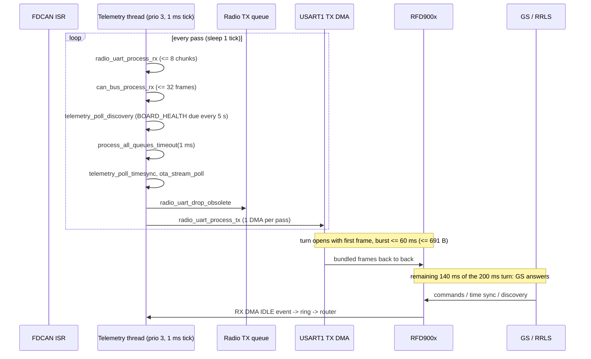

# RF board data pipeline

RFBoard26 (STM32G491, SEDSnet sender `RF`) is the relay between the
avionics CAN-FD network (FC, PowerBoard) and the RFD900x ground radio. It
also produces its own GPS stream (u-blox NEO-M9N on SPI1) and its
`BOARD_HEALTH`. It has **no SD card**: nothing the board relays or measures
is stored on the board. The LaunchCore persistent store holds only state
(cached flight state, boot identity, recovery floor, commissioning record,
underglow, RFD modem check marker; see `README.md`).

All numbers below come from the code on `dev`. File and macro names are
given so they can be re-checked. "Profile" means the values CMake reads
from `config/rfd-profile.json` on every configure (`CMakeLists.txt:51-67`,
`scripts/rfd_profile.py`), which override the C defaults in `radio.c`.

## 1. Data path

The RF board does not choose destinations itself. SEDSnet discovery and
learned subscriptions route each packet to the side(s) that need it
(`README.md`; `telemetry.c:1042-1066`). Uplink commands and time sync go
radio to CAN; rocket telemetry and the board's own packets go CAN/local to
radio.

## 2. Schedule

There is one service loop (telemetry thread) that does all relay work. The
GPS thread runs beside it at lower priority. The radio TX side runs in
air "turns" because the shipped profile sets `turn_period_ms = 200`.

```mermaid
gantt
  title Radio turn (shipped profile, RADIO_TURN_PERIOD_MS = 200)
  dateFormat x
  axisFormat %L ms
  section RF UART
  RF burst (<= 60 ms, <= 691 B at 115200)   :a1, 0, 60
  RF quiet, only control frames may start   :a2, 60, 200
  RF burst                                   :a3, 200, 260
  section GS
  GS gap write                              :b1, 60, 200
  section GPS thread
  NMEA read + sleep 50 ticks                :c1, 0, 50
  NMEA read + sleep 50 ticks                :c2, 50, 100
  NMEA read + sleep 50 ticks                :c3, 100, 150
  NMEA read + sleep 50 ticks                :c4, 150, 200
```

## 3. Threads, timers, ISRs and DMA

ThreadX tick is 1000 Hz (`tx_user.h:240 TX_TIMER_TICKS_PER_SECOND`).
Lower ThreadX number = higher priority; lower NVIC number = higher priority.

| Context | Priority | Period / trigger | Work | Source |
| --- | --- | --- | --- | --- |
| Telemetry thread | ThreadX 3, no time slice, 14 KiB stack | loop, `tx_thread_sleep(1)` | RFD modem check at boot, CAN init, router; each pass: radio RX, CAN RX, discovery + BOARD_HEALTH, router queues (1 ms budget), time sync, OTA, obsolete drop, radio TX | `telemetry_thread.c:29-33,166-206` |
| NEO-M9N thread | ThreadX 4, 12 KiB static stack | 5 s start delay, then loop with `tx_thread_sleep(50)` | Reads one NMEA sentence (SPI, 20 ms byte timeout, up to 500 ignored sentences), publishes GPS streams, feeds network clock | `neom9n_thread.c:289,377,563,577-588`; `neom9n.h:27-28` |
| USBX device thread | ThreadX 10 | USB events | CDC-ACM console only, no telemetry | `USBX/App/app_usbx_device.h:48` |
| FDCAN2_IT0 / IT1 | NVIC 6 | RX FIFO new message, TX complete | Drain HW FIFO into 64-frame ring (drop oldest), TX-complete stamp for time sync | `stm32g4xx_hal_msp.c:127-129`; `can_bus.c:359,458` |
| USART1 | NVIC 7 | IDLE / errors | `HAL_UARTEx_RxEventCallback` copies new bytes into 1024 B ring; `HAL_UART_TxCpltCallback` ends TX, turn and ACK timing | `stm32g4xx_hal_msp.c:315`; `radio.c:2652,2689` |
| DMA1_Ch1 (USART1 RX) | NVIC 7, DMA high | circular 256 B (`RADIO_UART_RX_BUF_SIZE`) | Continuous RX, never re-armed per event | `stm32g4xx_hal_msp.c:281-289`; `main.c:407` |
| DMA1_Ch2 (USART1 TX) | NVIC 7 | one transfer per dequeued batch | Radio TX; recovered after `tx_timeout + 50 ms` (timeout = wire time + 100 ms, floor 100 ms) | `stm32g4xx_hal_msp.c:298-305`; `radio.c:17-18,2055` |
| TIM6 | `TICK_INT_PRIORITY` 15 | 1 ms | HAL tick | `stm32g4xx_hal_timebase_tim.c`, `stm32g4xx_hal_conf.h:184` |
| USB_LP | NVIC 5 | USB | CDC | `stm32g4xx_hal_msp.c:387` |

There are no ThreadX timers (`tx_timer_create` is not used); every periodic
job is a deadline checked in one of the two threads.

## 4. Streams

### 4.1 Streams the RF board produces

The GPS publish period is `rf_telemetry_period_ms()` =
`round(1000 / RF_TELEMETRY_RATE_HZ)`, default `RF_TELEMETRY_RATE_HZ = 1`
(`telemetry_rate.h:8-9`, `telemetry_rate.c`), so **1000 ms**. The module
itself is configured to 4 Hz (`neom9n_config.c:20`, `GPS_CONFIG_ROCKET_SAFE`,
RAM layer only, dynamic model AIR4). Each GPS packet is sent once per period
if `log_telemetry_asynchronous` succeeds; on failure it is tried again on the
next loop (about 50 ms later). No filtering or averaging: the last parsed
sentence is sent.

| Stream (SEDSnet type) | Source | Sample / read | Send rate | Payload, units | Schema priority / reliability | Notes | Source |
| --- | --- | --- | --- | --- | --- | --- | --- |
| `GPS_DATA` | NEO-M9N GGA | 4 Hz module, read every ~50 ms | 1 Hz, only with a valid fix | Float32 x3: lat, lon (deg), altitude MSL (m) | 255 (radio queue clamps to 253), `Off` | Also sets network UTC via `telemetry_set_unix_time_ms` when date/time is valid | `neom9n_thread.c:419-438`; `neom9n.c:57-61` |
| `GPS_SATELLITE_NUMBER` | GGA | as above | 1 Hz, always | UInt8; 0 if no satellite update for 5000 ms (`GPS_SATELLITE_STALE_MS`) | 0, `Off` | | `neom9n_thread.c:110,133-176` |
| `GPS_STATUS` | driver state | as above | 1 Hz, always | Float32 x4: state (0 no response, 1 silent >3000 ms, 2 no fix, 3 fix), satellites, last-byte age (s), last-fix age (s), -1 if never | 16, `Off` | Lets the GS tell no module / no fix / no data path | `neom9n.c:72-100`; `neom9n.h:95-100` |
| `WARNING` | GPS thread | on event | no link (once), no fix after 100 failed reads (once per episode), errors after 20 consecutive failures (each kind at most every 5 min) | String | 0, `Unordered` | | `neom9n_thread.c:109-115,474-552` |
| `MESSAGE_DATA` | GPS thread | boot | once after configuration | String | 0, `Off` | | `neom9n_thread.c:296-310` |
| `BOARD_HEALTH` | `board_health_poll` | 5000 ms | 0.2 Hz | UInt32 x24 (version 1). RF words: 12 CAN RX drops, 14 UART RX ring drops, 13/15/22 RFD modem check, 16..21 "RFT1" radio TX timing (ACK frames, mean/max enqueue-to-DMA ms, queue high water of 12, stale drops) | 0, `Off` | Logged through `seds_router_log_bytes_ex` | `board_health.c:31-77`; `radio.c:2792-2805` |
| `BOARD_STATE_STATUS` | recovery query | on `BOARD_RECOVERY_REQUEST` | on request | UInt8 x40 | 200, `Unordered` | | `board_recovery_transport.c:79` |
| Time sync | SEDSnet | announce / request every 2000 ms, source timeout 5000 ms, GPS holdover 30000 ms | | network control | 254 | TX stamped at UART/CAN TX-complete | `telemetry.c:62-78,313-317,762-775` |
| `FLIGHT_STATE`, `AV_BAY_UNDERGLOW` | managed variables | on change / request | | UInt8 | network control | cached in the persistent store | `flight_state_cache.c`, `av_bay_underglow.c` |

### 4.2 Relayed streams

Rocket telemetry from the FC and the PowerBoard (for example `IMU_DATA`,
`BAROMETER_DATA`, `BATTERY_VOLTAGE`, `BATTERY_CURRENT`, their `BOARD_HEALTH`
and `HEARTBEAT`) and ground commands (`FLIGHT_COMMAND`, `ABORT`,
`ACTUATOR_COMMAND`, `BOARD_RECOVERY_REQUEST`, time sync, discovery) cross the
board. Their **sample and send rates are set by the producing board**; see
that board's `docs/data-pipeline.md`. RF adds no filtering and no unit
conversion; it forwards SEDSnet packets. What RF controls is the order and
timing of radio egress:

| Direction | Ingress buffer and drop | Egress buffer and drop | Priority / egress policy | Source |
| --- | --- | --- | --- | --- |
| CAN to radio (rocket to ground) | HW FIFO to 64-frame ring, **drop oldest** when full (counted in BOARD_HEALTH word 12); thread drains <= 32 frames/pass; 4 reassembly slots, 2048 B, 64 fragments, 1000 ms timeout | Radio TX queue, see 4.3. Ordinary frames refused with `HAL_BUSY` stay in SEDSnet's own queue (queue budget 16384 B, `RF_SEDSNET_QUEUE_BUDGET`) | Latest-value egress on the radio side: pending telemetry of the same flow is replaced before encoding (`SEDSNET_LATEST_VALUE_EGRESS=ON`). Compact bundles on the radio side | `can_bus.c:55,359,458-467,564-572,335`; `CMakeLists.txt:32-34,262`; `telemetry.c:1094-1119` |
| Radio to CAN (ground to rocket) | 256 B circular DMA, 1024 B ring; a chunk that does not fit is **rejected whole** (word 14); thread drains <= 8 chunks/pass; frame buffer 1028 B, damaged partial frame dropped after 2000 ms | `can_tx_queue`: 48 packets, 6144 B, packets older than 1000 ms are dropped at the head; IDs < 0x80 (ACKs, small controls, discovery schema) jump ahead of data; data keeps 12 slots / 1536 B in reserve for controls | CAN ID bands from `board_can_arbitration_id`: 0x001 controls/heartbeat, 0x081 schema/SDT control, 0x101 data | `radio.c:15,45,60,207,2510-2530,2559-2585`; `can_tx_queue.c:6-12,70-77,102-109,182-191`; `board_can_priority.h` |

Reliable SEDSnet traffic is retransmitted after 550 ms, up to 8 times
(`telemetry.c:1010-1011`). SEDSnet hop ACKs are disabled on the radio side
(`README.md`); the RFD900x's own retries cover the air link.

### 4.3 Radio egress queue and drop policy

| Item | Value | Source |
| --- | --- | --- |
| UART | 115200 baud, 8N1 (11.52 B/ms) | `radio.h:13`, `main.c:328` |
| Frame | 4 B header (`A5 5A len16`), SEDSnet payload <= 192 B on the radio side (`RF_RADIO_MAX_FRAME_BYTES`), max 1024 B accepted | `radio.c:24-32`; `telemetry.c:128,1058-1061` |
| Queue | 12 descriptors (`RADIO_UART_TX_QUEUE_SLOTS`), 2056 B (`2 x 1028`) | `radio.c:49-53,67` |
| Control reserve | 2 slots and 256 B usable only by independent control frames (ACKs, commands, managed values) | `radio.c:69-70,1031-1040` |
| Ordinary lookahead | ordinary bytes owned ahead of the UART <= 516 B (`RADIO_TURN_BUNDLE_BYTES`) when turns are on, else 196 B | `radio.c:996-1029,1090-1100` |
| Admission | Router path (`enqueue_sedsnet_parts`) never evicts: over a limit it returns `HAL_BUSY` and SEDSnet keeps the packet. Exact duplicate of a frame still queued or in DMA is refused | `radio.c:951-1060` |
| Dequeue order | up to 7 independent control frames in a row (highest priority first, FIFO within a priority), then one FIFO turn | `radio.c:1177-1213,1442-1462` |
| Batching | adjacent ordinary frames of the same priority are packed into one DMA run of compact bundles, each from <= 160 B of SDK frames; ACK groups up to 4 frames | `radio.c:1112-1172,1240-1295` |
| Obsolete drop | each pass, small (<= 96 B) single ordinary frames whose relayed reliable copy every destination already ACKed are removed | `radio.c:2604-2634`; `telemetry.c:480-484` |
| Air turns (shipped) | period 200 ms (profile `turn_period_ms`), burst 30% = 60 ms = 691 UART bytes; an ordinary frame waits for the next turn once the UART has been idle 5 ms inside the burst; control frames may still start | `radio.c:388-447,455-462,1659-1674` |
| Air pacing (no turns) | `quiet = ceil((len + 16) x 8000 / air_bps)` with `air_bps = 30000 x 100%` (profile), lowered to `64000 x 0.94 / (1 + S5)` from the modem readback; burst 250 ms / gap 15 ms (profile); heard air charged up to 60% | `radio.c:1383-1440,1486-1522` |

With turns on, `radio_uart_quiet_remaining_ms` returns before the air-time
and burst/gap terms (`radio.c:1662-1674`), so for the shipped profile the
**turn alone limits RF egress**: at most 691 B per 200 ms, about 3.4 KB/s of
UART bytes, including headers and bundle overhead. The code comment at
`radio.c:395-399` states the AV bay produces about 1.4-1.5 KB/s.

Latency, as bounded by the code (not measured): an ordinary packet waits for
the current turn to end (<= 200 ms), plus its UART time (196 B frame = 17 ms),
plus modem air time. A backlog does not age out in the RF queue; it is
bounded by `HAL_BUSY` backpressure into SEDSnet and by latest-value
replacement there. BOARD_HEALTH words 17..20 report the measured
enqueue-to-DMA-complete time of ACK frames and the queue high water.

## 5. Where each stream ends up

The RF board stores nothing. Everything below is what reaches the ground
station (or an RRLS, which records its own ring) over the radio.

GS path: RFD900x UART -> GS SEDSnet router -> `telemetry_task`
(`GroundStation26/backend/src/telemetry_task.rs`). Every decoded packet is
written to the always-on rolling SQLite ring (`data/recordings/rolling/`,
64 MB segments, oldest deleted first) and copied into event captures (launch:
10 min pre-roll, 5 min post-roll; abort, sequences, IGT, manual), see
`GroundStation26/docs/backend/rolling-recording.md`.
`should_persist_telemetry_sample` returns `true` for every sample
(`telemetry_task/derived.rs:47-54`): the GS does not decimate.

| Stream | GS decoding / use | Saved by GS |
| --- | --- | --- |
| `GPS_DATA` (RF) | f32 row; antenna tracking source (`antenna::observe_source_gps`, `telemetry_task.rs:3432`), map, speed estimate | yes, telemetry row in ring and captures |
| `GPS_SATELLITE_NUMBER` | `handle_gps_satellite_count_packet` (`telemetry_task.rs:3228`) | yes |
| `GPS_STATUS` | f32 row shown on the dashboard (test `rf_gps_status_becomes_a_displayed_telemetry_row`, `telemetry_task.rs:6589-6617`) | yes |
| `BOARD_HEALTH` (RF) | `network_health.observe_diagnostics_with_source`; RFT1 words (`network_health.rs:226-227`); RFD modem check notice (`comms/rfd_modem.rs:1690`) | raw words via `recording_diagnostics::raw_health` (`telemetry_task.rs:2823-2858`) |
| `WARNING` | operator warning (`web.rs:6574`) | warning log in the DB, not a telemetry row (`telemetry_task.rs:2861-2888`) |
| `MESSAGE_DATA` | message row | yes, as message |
| Relayed FC / PB streams | per their own docs | yes, as rows from sender `FC` / `PB` |

| Data | On the RF board | Reaches GS | Saved by GS |
| --- | --- | --- | --- |
| GPS position, satellites, status | RAM only, last value | 1 Hz each (if the radio carries it) | ring + captures |
| BOARD_HEALTH | RAM counters | every 5 s | raw words |
| Relayed rocket telemetry | not stored; latest pending value per flow | at the producer's rate, minus latest-value replacement when the radio is behind | ring + captures |
| Flight state, underglow, modem check marker | persistent store (state, not logs) | managed variables / health words | yes |

There is no RF "launch file". If the link drops, RF data from that interval
is lost: the FC SD card is the only on-vehicle record (see FlightComputer26).

The schema difference noted in review is not a problem: RF's
`config/sedsnet.json` has `GPS_DATA` priority 255 and the `GPS_STATUS` type,
which the PowerBoard and Gateway schemas do not. The GS schema has both
(`backend/config/telemetry_config.json`), the GS contract test requires every
AV-bay board schema to be a subset of the station's and ignores priority,
which is local transport scheduling only
(`GroundStation26/backend/src/av_bay_schema_contract.rs:1-13`). The GS
snapshot `backend/tests/board-schemas/RFBoard26.json` matches the RF
`dev` schema, and `backend/comms/rfd-profile.json` matches
`config/rfd-profile.json`.

## 6. Disagreements between code and older docs

| Doc | Says | Code |
| --- | --- | --- |
| `docs/rfd900-air-budget.md` (before board-bugfix-20261123; now corrected) | envelope 32000 bit/s, RF share 35%; burst/gap 100/55 ms; no radio turns | profile 30000 bit/s, 100%; burst/gap 250/15 ms; `turn_period_ms = 200` enables turns, which replace the limiter |
| `telemetry.c:125-127` comment | 64 kbit/s with 40% share | only true for the LoRa build (`RFBOARD_LORA_SCHEDULER`) |
| `radio.c:2739-2740` comment, README word 21 | queued frames "age out"; stale-drop count | the 1500 ms age-out (`RADIO_UART_TX_MAX_AGE_MS`) runs only in `radio_uart_enqueue_frame` (`radio.c:873`), used for profile replies; router traffic is never aged out, so word 21 stays 0 in practice |

## 7. Known gaps / bugs found

1. **Fixed (board-bugfix-20261123): CAN time-sync TX-stamp watch could latch
   until reboot.** Every path that loses the watched packet now returns
   `watch_state` to 0: expiry or reset while queued, a bus-off reset that
   aborts the hardware buffer, a refused or oversize submit (the request
   applies to one submit only), a send refused before the queue
   (`can_tx_queue_watch_disarm()` after `can_bus_send_large`), and a
   completion that never arrives (abandoned after `CAN_TX_MAX_AGE_MS`).
   `g_can_tx_watch_abandoned` counts them; `tests/test_can_tx_queue.py`
   covers each path. Original finding:
   `can_tx_queue_watch_next()` arms only when `watch_state` is not 2 or 3
   (`can_tx_queue.c:37`). State 2 is cleared only when the watched packet's
   last fragment is submitted (`can_tx_queue.c:127-129`), state 3 only by
   `can_tx_queue_note_complete()` (`can_tx_queue.c:39-43`). If the watched
   packet expires at the queue head (`can_tx_queue.c:105-108`,
   `CAN_TX_MAX_AGE_MS`) or is dropped by `can_tx_queue_reset()`
   (`can_tx_queue.c:200-205`, called from bus-off recovery after
   `HAL_FDCAN_AbortTxRequest`, `can_bus.c:289-299`), `watch_state` is never
   reset. `seds_router_note_frame_sent()` for the CAN side
   (`telemetry.c:771-773`) is then never called again, and CAN-side time-sync
   exchanges lose their TX-complete stamp.
   Related: if `can_tx_queue_submit` refuses the packet after `watch_next`
   set state 1 (`can_tx_queue.c:150-153,169-173`), or the packet is over
   72 B, state 1 stays set and the next unrelated packet <= 72 B is watched.
2. **Radio TX-stamp watch can stamp the wrong DMA.** Once the watched frame
   is in a DMA (`state 2`, `radio.c:280-289`), any later TX-complete sets
   state 3 (`radio.c:300-305`). If that DMA fails or times out and the
   requeue fails (`radio.c:2050-2070,2174-2179`), the next unrelated DMA
   completion stamps the watched frame. Low impact: only after a DMA error.
3. **Radio stale-drop counter does not cover router traffic.** See section 6:
   BOARD_HEALTH word 21 cannot show backlog age for SEDSnet frames. Use words
   17..20 and the GS receive time instead.
4. **Resolved (board-bugfix-20261123): air-time pacing is inactive in the
   shipped profile, by decision.** With `RADIO_TURN_PERIOD_MS > 0` the
   turns alone limit RF egress; the 30000 bit/s budget, the S5 correction and
   heard-air charging apply only to profiles without turns
   (`radio.c:1662-1674`). Layering the limiter on the turns was evaluated and
   rejected: it limits each turn to one write, the AV-bay backlog grows
   without bound at 1.5 KB/s, and control latency rises. Turn shares are
   unchanged. `docs/rfd900-air-budget.md` now describes this, with the
   evidence, and `tests/test_radio_turn_cadence.py` pins it.
5. **No on-board record.** RF has no SD card; anything not delivered over the
   radio (link loss, latest-value replacement under backlog) is not recorded
   anywhere by RF.
